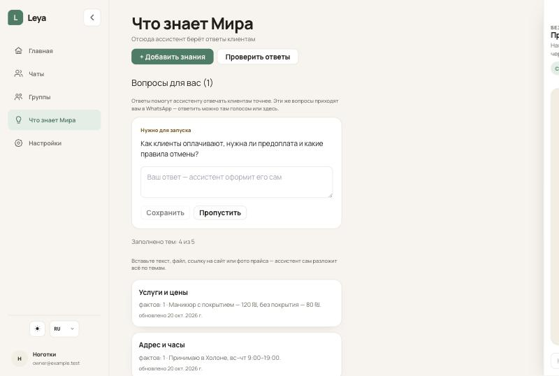
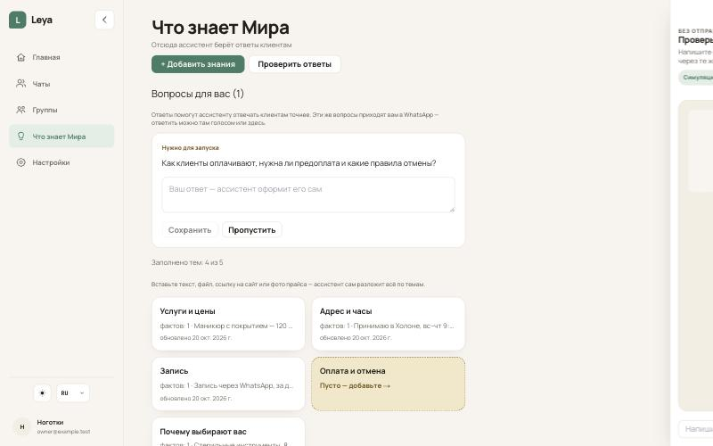
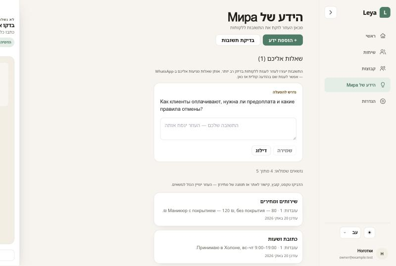
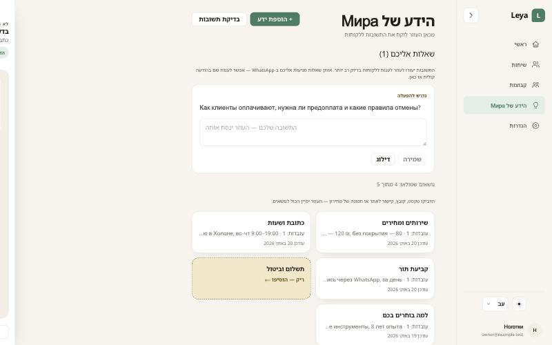
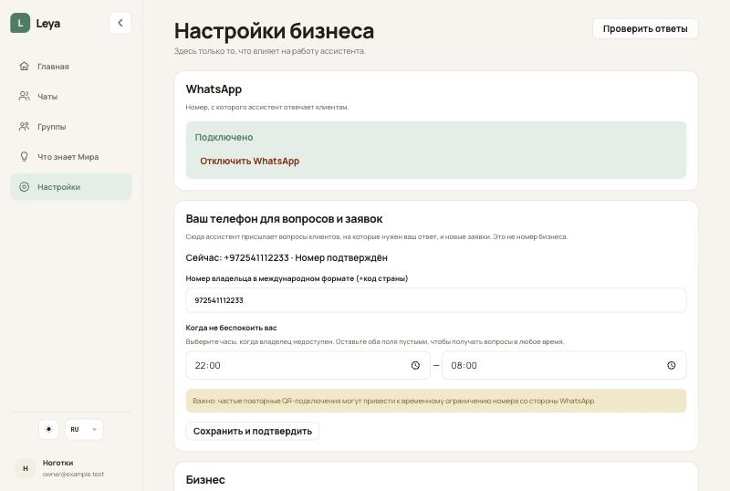
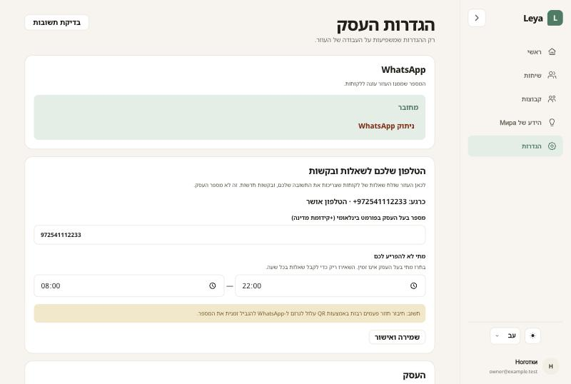
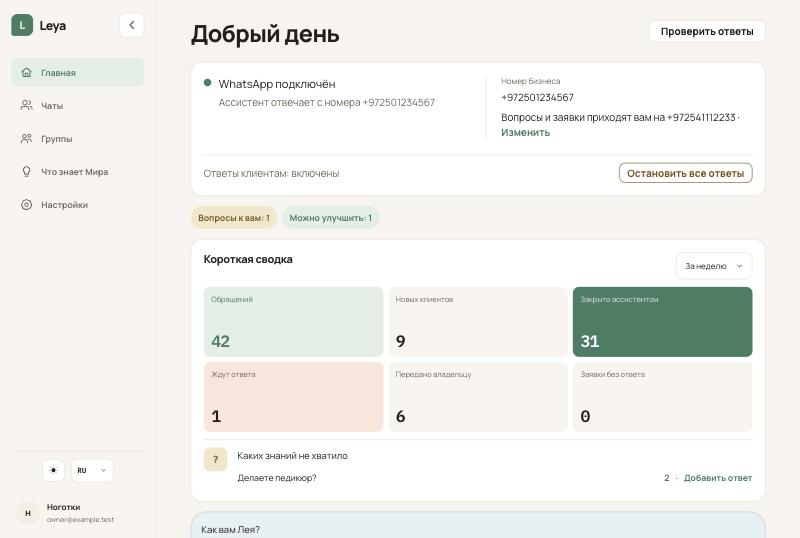

# Z8.1 — «Настройки» без выброса на вход, «Чаты», сетки при открытом симуляторе, «Ответы клиентам» в карточке WhatsApp

Скриншоты — локальный кабинет на моках Supabase и API бэкенда; данные условные. Поведение модели не затронуто — eval не нужен.

| | |
|---|---|
| «Что знает» + симулятор, ru 1280 (1 колонка) |  |
| «Что знает» + симулятор, ru 1440 (2 колонки) |  |
| «Что знает» + симулятор, he 1280 |  |
| «Что знает» + симулятор, he 1440 |  |
| «Настройки» и меню с названием бизнеса, ru |  |
| «Настройки» и меню с названием бизнеса, he |  |
| Главная: «Ответы клиентам: включены» |  |
